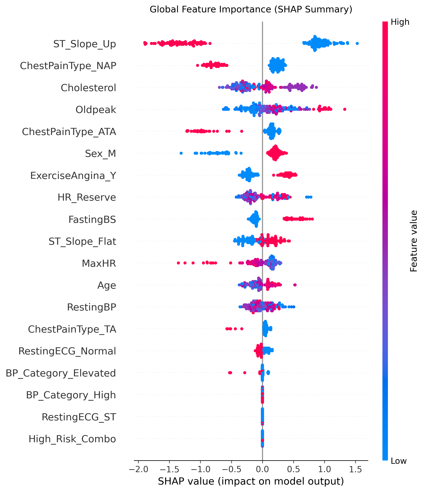
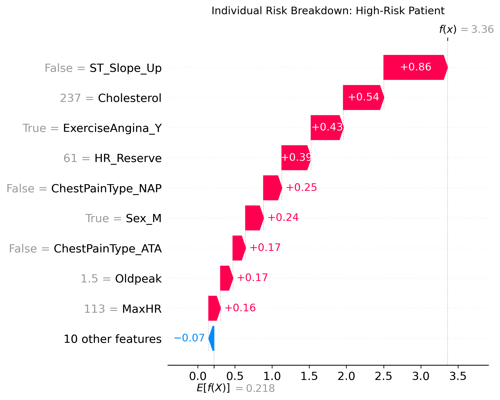

# 🫀 Heart Disease Risk Prediction (XGBoost & SHAP)

A machine learning project that predicts a patient's risk of heart failure using clinical data, adjusts prediction thresholds to catch more high-risk cases, and uses SHAP charts to explain why the model makes each prediction.

---

## 📊 Dataset & Data Cleaning
- **Dataset:** Heart Failure Clinical Records (*Chicco & Jurman, 2020*), containing **918 patient records** and **11 clinical measurements** (such as age, blood pressure, cholesterol, and ECG results).
- **Fixing Missing/Invalid Values:** Found several records where `Cholesterol` (~18.7% of rows) and `RestingBP` were recorded as `0`—which is medically impossible. Replaced those zeros with the median value so they wouldn't skew the model.
- **New Features Created:**
  * `HR_Reserve`: The gap between a patient's estimated max heart rate (`220 - Age`) and the max heart rate they actually reached.
  * `High_Risk_Combo`: Flags patients who have *both* high fasting blood sugar (`> 120 mg/dl`) and chest pain during exercise.
  * `BP_Category`: Groups resting blood pressure into standard medical ranges (`Normal`, `Elevated`, `High`).

---

## 🏆 Model Comparison & Results
The data was split 80/20 for training and testing. Three models were tested at the default `0.50` probability cutoff:

| Model | Recall (Sensitivity) | Precision | F1-Score | ROC-AUC |
| :--- | :---: | :---: | :---: | :---: |
| **Logistic Regression (Baseline)** | `0.912` | `0.894` | `0.903` | `0.931` |
| **Random Forest** | `0.863` | `0.889` | `0.876` | `0.926` |
| **XGBoost Classifier (Final)** | **`0.882`** | **`0.882`** | **`0.882`** | **`0.927`** |

> **Why XGBoost?** Even though Logistic Regression scored slightly higher on the default test (`0.931` vs. `0.927` ROC-AUC), **XGBoost** was chosen as the final model because it captures complex interactions between symptoms and pairs cleanly with SHAP to explain individual patient predictions.

### Lowering the Threshold to Catch More High-Risk Patients
In healthcare screening, missing a sick patient (**False Negative**) is much worse than flagging a healthy patient for a follow-up check (**False Positive**). By lowering the cutoff threshold from `0.50` to **`0.40`**:
- **Recall jumped from `88.2%` to `93.1%`** (catching more true heart disease cases than any baseline model).
- **Precision stayed strong at `86.4%`**, giving an overall **F1-score of `0.896`**.

---

## 🔍 Explaining the Model with SHAP

### What Drives Risk Overall?
Across all patients, the biggest warning signs were an abnormal **ST slope** (`Flat` or `Down`), **asymptomatic chest pain** (`ASY`), **ST depression** (`Oldpeak`), and **exercise-induced angina**. This matches real-world cardiology guidelines.

### Explaining a Single Patient's Prediction
Instead of treating the model like a black box, SHAP waterfall charts break down exactly which symptoms pushed an individual patient's risk score higher or lower:

---

## 🛠️ Tools Used
- **Data Cleaning & Analysis:** `Python`, `pandas`, `NumPy`
- **Machine Learning:** `XGBoost`, `scikit-learn`
- **Charts & Explainability:** `SHAP`, `Matplotlib`

---

## ⚠️ Disclaimer
*This project is for educational and portfolio purposes only. It is not a medical tool and should not be used for real-world diagnosis.*
